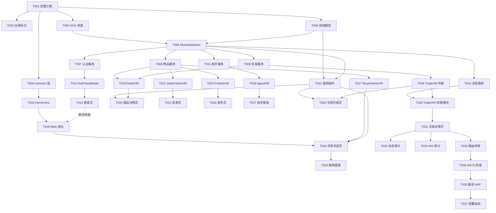

# Tasks: CampusBazaar 校园二手商品交易平台

**Input**: Design documents from `D:\Dev\DevEco_Repos\spec\campus-bazaar\`  
**Prerequisites**: plan.md (Rev.2，已批准)，spec.md (Rev.3，已确认，9 个用户故事)  

**Tests**: 未要求自动化测试任务（spec 无 TDD 要求），验证以 ArkTS 静态检查 + HAP 编译 + 模拟器部署为准（见 Verification 阶段）。  

**Organization**: 任务按用户故事分组（US1–US9，P1 → P2 顺序），每个故事可独立实现与验证。

**Revision**: Rev.2 —— 按 Phase 3 审批意见补充三点：① T018/T022/T029 增加 NavDestination onShown 页面重新显示时的数据刷新要求；② T030 明确 Mock 自动回复的消息刷新机制与页面离开失效防护；③ T005/T006/T012 明确 Product.images 始终为 string[]、`mock:` 资源仅在渲染边界（ProductCard/公共图片解析函数）转换为 Resource。任务编号、依赖关系、优先级与 Verification 范围（build-only）不变。

## Format: `[ID] [P?] [Story] Description`

- **[P]**: 可并行（不同文件、无未完成依赖）
- **[Story]**: 所属用户故事（US1–US9）；Setup/Foundational/Polish/Verification 阶段无故事标签
- 所有任务描述均含精确文件路径

## Path Conventions

- 工程根：`D:\Dev\DevEco_Repos\CampusBazaar\`（由 T001 创建）
- 下文任务中的相对路径均相对工程根，例如 `entry/src/main/ets/pages/Index.ets` 即 `D:\Dev\DevEco_Repos\CampusBazaar\entry\src\main\ets\pages\Index.ets`

## Phase 1: Setup (Shared Infrastructure)

**Purpose**: 工程初始化与基础资源配置

- [ ] T001 通过 deveco-create-project skill 创建 HarmonyOS 工程骨架（参数：projectPath=D:\Dev\DevEco_Repos、appName=CampusBazaar、bundleName=edu.fudan.campusbazaar、apiLevel=23），完成后校验 `build-profile.json5` 存在且 compatibleSdkVersion 为 6.1.0(23)，工程根：`D:\Dev\DevEco_Repos\CampusBazaar\`
- [ ] T002 [P] 配置应用标识：确认 `AppScope/app.json5` 的 bundleName 为 edu.fudan.campusbazaar，设置 `AppScope/resources/base/element/string.json` 的 app_name 为 CampusBazaar，并核对 `entry/src/main/module.json5` 与 EntryAbility 加载页为 pages/Index
- [ ] T003 [P] 生成 12 个 SVG Mock 媒体资源（mock_bike、mock_book、mock_lamp、mock_earphone、mock_chair、mock_kettle、mock_keyboard、mock_plant、avatar_me、avatar_lily、avatar_wei、avatar_ming；纯色背景+图形/文字、显式 width/height/viewBox）至 `entry/src/main/resources/base/media/`

**Checkpoint**: 工程骨架可编译，身份与媒体资源就绪

---

## Phase 2: Foundational (Blocking Prerequisites)

**Purpose**: 全部用户故事共同依赖的模型、数据、服务与通用组件

**⚠️ CRITICAL**: 本阶段完成前不得开始任何用户故事

- [ ] T004 [P] 创建公共层：`entry/src/main/ets/common/Constants.ets`（路由名常量、交易状态文案与配色、照片上限 3、Mock 延时参数）与 `entry/src/main/ets/common/Utils.ets`（时间格式化、价格格式化、手机号 11 位校验、验证码 6 位校验、价格 > 0 校验）
- [ ] T005 定义领域模型：`entry/src/main/ets/model/Models.ets`（User、Product（images 始终为 string[]，仅存 `mock:` 资源键或 `photo:///`/`file://` URI 字符串，禁止向领域模型保存 $r() Resource 对象）、Transaction、Message、TransactionStatus 枚举（PENDING/ACCEPTED/REJECTED/COMPLETED）、ProductDetail/TransactionListItem/TransactionDetail/AgentResult/PublishDraft DTO）
- [ ] T006 实现 Mock 数据层：`entry/src/main/ets/data/MockDataStore.ets`（种子数据：4 用户 u_me/u_lily/u_wei/u_ming、8 商品 p_bike…p_plant（含当前用户自己的 2 件）、3 笔预置交易 t_pending（当前用户为卖家·PENDING·1 条消息）/t_accepted（当前用户为买家·ACCEPTED·4 条消息）/t_completed（COMPLETED·4 条消息）；内存仓库；当前会话持有；`mock:` 前缀图片键→$r('app.media.xxx') 的映射表与导出的公共图片解析函数（仅作为渲染边界转换：`mock:` 键转换为对应 Resource、URI 字符串原样返回；仓库存储与返回的 images 一律为 string[]，不向领域模型写入 Resource））
- [ ] T007 [P] 实现认证服务：`entry/src/main/ets/service/AuthenticationService.ets`（AuthenticationService 接口 + MockAuthenticationService：sendSmsCode（11 位手机号校验）、loginByPhone（11 位手机号 + 6 位数字验证码，任意合法输入通过）、loginByCas（任意非空学号/密码）、getCurrentUser、logout + 单例导出 authService）
- [ ] T008 [P] 实现商品服务：`entry/src/main/ets/service/ProductService.ets`（接口 + MockProductService：getProductFeed（publishTime 倒序）、searchByKeyword（title 模糊包含、不区分大小写）、getProductsBySeller、getProductDetail（嵌套 seller，未找到返回 null）、publishProduct（校验入库、publishTime=当前时间）+ 单例导出 productService）
- [ ] T009 [P] 实现交易服务：`entry/src/main/ets/service/TransactionService.ets`（接口 + MockTransactionService：getTransactionsForUser（买家∪卖家视角、createTime 倒序）、getTransactionDetail、createTransaction（恒 PENDING；买家=卖家 reject；同一买家同一商品已存在 PENDING/ACCEPTED 交易 reject「该商品已有进行中的交易」；REJECTED/COMPLETED 历史不阻止）、acceptTransaction/rejectTransaction（仅卖家+PENDING，否则 reject）、completeTransaction（仅卖家+ACCEPTED，否则 reject）+ 单例导出 transactionService）
- [ ] T010 [P] 实现消息服务：`entry/src/main/ets/service/MessageService.ets`（接口 + MockMessageService：getMessages（sendTime 升序）、sendMessage（成功后延时约 800ms 生成对手方自动回复，仅追加聊天消息、不修改交易状态，语料按轮次轮询）+ 单例导出 messageService）
- [ ] T011 [P] 实现智能助手服务：`entry/src/main/ets/service/AgentService.ets`（接口 + MockAgentService：queryByNaturalLanguage（关键词+同义词表匹配商品 title/description、返回 replyText 与命中商品数组、无命中返回空数组+引导话术、延时约 600ms）+ 单例导出 agentService）
- [ ] T012 实现通用组件：`entry/src/main/ets/components/ProductCard.ets`（双图源渲染：`mock:` 资源键经公共图片解析函数转换为 $r('app.media.xxx') 对应 Resource、photo:///file:// URI 直接作为 Image URI 渲染，Resource 转换仅发生在 ProductCard/公共图片解析函数这一渲染边界；图片+名称+价格卡片，供商品流/搜索结果/助手结果复用）与 `entry/src/main/ets/components/StateView.ets`（loading/empty/error 三态组件，支持自定义文案与重试回调）

**Checkpoint**: 模型、Mock 数据、5 个 Service 接缝、通用组件就绪 —— 用户故事可开始

---

## Phase 3: User Story 1 - Mock 登录进入主页（含获取验证码） (Priority: P1) 🎯 MVP

**Goal**: 手机号（获取验证码 + 验证码）/ 校园 CAS 双入口 Mock 登录，成功后进入主页面  
**Independent Test**: 启动应用 → 手机号模式「获取验证码 → Toast → 输入验证码 → 登录」或 CAS 模式登录 → 跳转主页面；非法输入被拦截

- [ ] T013 [P] [US1] 实现登录状态编排：`entry/src/main/ets/viewmodel/AuthViewModel.ets`（@ObservedV2：phone/cas 模式切换、字段级校验标记、「获取验证码」按钮可用性=手机号格式合法、smsCodeSent 标记、登录进行中态、调用 authService 完成登录）
- [ ] T014 [US1] 实现登录页：`entry/src/main/ets/pages/Index.ets`（手机号/校园 CAS 双入口切换、手机号模式：手机号输入+「获取验证码」按钮+验证码输入、CAS 模式：学号+密码、Mock 提示文案、字段红字校验、登录成功后 Toast 并 router.replaceUrl('pages/Main')）

**Checkpoint**: US1 功能完整；与 US2（pages/Main）联合验收登录跳转闭环

---

## Phase 4: User Story 2 - 主页面三入口导航（同一用户双角色） (Priority: P1) 🎯 MVP

**Goal**: 主页面醒目展示「我是买家」「我是卖家」与「交易提醒」三入口并正确导航  
**Independent Test**: 登录后在主页面点击三个入口，分别跳转买家浏览页、卖家页、交易提醒页

- [ ] T015 [P] [US2] 实现主页视图：`entry/src/main/ets/views/HomeView.ets`（当前用户问候区、醒目的「我是买家」「我是卖家」双入口卡片、「交易提醒」入口，点击经 NavPathStack 跳转对应路由）
- [ ] T016 [US2] 实现 Navigation 宿主页：`entry/src/main/ets/pages/Main.ets`（Navigation + NavPathStack + navDestination pageMap 路由表，HomeView 为首页内容）并在 `entry/src/main/resources/base/profile/main_pages.json` 注册 pages/Main、核对 EntryAbility loadContent('pages/Index') 保持同步

**Checkpoint**: US1 + US2 联合闭环：登录 → 主页面 → 三入口可跳转（后续故事路由逐步注册）

---

## Phase 5: User Story 3 - 买家浏览商品（含自己的商品） (Priority: P1) 🎯 MVP

**Goal**: WaterFlow 双列卡片商品流，发布时间倒序，含自己发布的商品；搜索/智能助手按钮可见  
**Independent Test**: 从主页「我是买家」进入，验证双列卡片流、倒序、自己的商品可见

- [ ] T017 [P] [US3] 实现买家浏览状态编排：`entry/src/main/ets/viewmodel/BuyerHomeViewModel.ets`（@ObservedV2：商品流 loading/empty/data 状态、publishTime 倒序加载、searchKeyword 搜索状态与结果集）
- [ ] T018 [US3] 实现买家浏览页：`entry/src/main/ets/views/BuyerHomeView.ets`（WaterFlow 双列 + ProductCard、顶部搜索按钮与智能助手按钮、StateView 三态、点击卡片跳转 'ProductDetail'、NavDestination onShown 页面重新显示时经 ViewModel 重新拉取商品流（发布商品/返回后立即可见最新数据，不得仅在初次创建时加载一次））并在 `entry/src/main/ets/pages/Main.ets` pageMap 注册 'BuyerHome' 路由

**Checkpoint**: 商品流完整展示（8 件预置商品含自己 2 件），倒序无错乱

---

## Phase 6: User Story 4 - 商品详情与购买请求 (Priority: P1) 🎯 MVP

**Goal**: 详情完整展示（多图/名称/描述/价格/卖家），购买确认后创建 PENDING 交易；自己商品不可购买；重复购买被拦截  
**Independent Test**: 点击商品卡片 → 详情完整 → 购买确认 → 交易提醒可见 PENDING 新交易；再次购买同一商品 Toast「该商品已有进行中的交易」

- [ ] T019 [P] [US4] 实现商品详情状态编排：`entry/src/main/ets/viewmodel/ProductDetailViewModel.ets`（详情加载（ProductDetail DTO）、卖家=当前用户判定、购买确认后调用 transactionService.createTransaction 创建 PENDING 交易、重复购买/自己商品/商品不存在等业务错误信息透出供 Toast）
- [ ] T020 [US4] 实现商品详情页：`entry/src/main/ets/views/ProductDetailView.ets`（Swiper 多图、名称/描述/价格/卖家信息卡、购买按钮：自己商品禁用并提示「不能购买自己发布的商品」、他人商品 AlertDialog 确认后创建 PENDING 并 Toast 成功、loading 与错误态）并在 `entry/src/main/ets/pages/Main.ets` pageMap 注册 'ProductDetail' 路由（参数 productId）

**Checkpoint**: 购买闭环可用（依赖 US8 页面查看交易记录，闭环在 US8 后联合验收）

---

## Phase 7: User Story 5 - 卖家商品列表与发布商品 (Priority: P1) 🎯 MVP

**Goal**: 卖家页展示我的商品列表；新增商品（名称/描述/价格/照片，拍照或相册最多 3 张）提交后立即出现在卖家列表与买家流  
**Independent Test**: 我是卖家 → 新增商品 → 填写+拍照/选图 → 提交 → 卖家列表与买家流顶部立即可见

- [ ] T021 [P] [US5] 实现卖家列表状态编排：`entry/src/main/ets/viewmodel/SellerHomeViewModel.ets`（@ObservedV2：当前用户商品加载、空态判断）
- [ ] T022 [US5] 实现卖家页：`entry/src/main/ets/views/SellerHomeView.ets`（我的商品列表：缩略图/名称/价格/发布时间、「新增商品」按钮跳转 'PublishPage'、StateView 三态（空态含去发布引导）、NavDestination onShown 页面重新显示时重新拉取我的商品列表（发布商品/返回后立即可见最新数据，不得仅在初次创建时加载一次））并在 `entry/src/main/ets/pages/Main.ets` pageMap 注册 'SellerHome' 路由
- [ ] T023 [P] [US5] 实现发布状态编排：`entry/src/main/ets/viewmodel/PublishViewModel.ets`（@ObservedV2 表单状态与校验：名称非空/描述非空/价格为大于 0 的合法数值、逐项错误标记；照片编排：@kit.CameraKit cameraPicker 拍照（resultCode=0 取 resultUri）+ @kit.MediaLibraryKit PhotoViewPicker 相册多选（maxSelectNumber=剩余可选数）、最多 3 张、取消/失败兜底不报错、提交调用 productService.publishProduct 后返回）
- [ ] T024 [US5] 实现商品发布页：`entry/src/main/ets/views/PublishProductView.ets`（名称 TextInput/描述 TextArea/价格 TextInput 表单+逐项校验红字、照片缩略图预览+「添加照片」入口（ActionSheet：拍摄照片/从相册选择）、已达 3 张提示、提交按钮进行中态、成功 Toast 后返回卖家页）并在 `entry/src/main/ets/pages/Main.ets` pageMap 注册 'PublishPage' 路由

**Checkpoint**: P1 全部故事（US1–US5）完成，构成 MVP 闭环

---

## Phase 8: User Story 6 - 搜索 Panel 模糊搜索 (Priority: P2)

**Goal**: bindSheet 半模态搜索面板，商品名称模糊搜索实时更新，结果可跳详情  
**Independent Test**: 买家页点搜索 → Panel 打开 → 输入关键词 → 仅名称匹配商品展示 → 点击结果进详情；无结果展示空态

- [ ] T025 [US6] 实现搜索半模态面板：`entry/src/main/ets/views/SearchSheetView.ets`（搜索输入框+防抖触发 productService.searchByKeyword、结果列表复用 ProductCard、点击结果关闭 Sheet 并跳转 'ProductDetail'、「无匹配商品」空态）并在 `entry/src/main/ets/views/BuyerHomeView.ets` 绑定 bindSheet（detents MEDIUM/LARGE）

**Checkpoint**: 搜索面板独立可用

---

## Phase 9: User Story 7 - 智能助手 Panel (Priority: P2)

**Goal**: bindSheet 半模态智能助手，自然语言输入经 Mock AgentService 返回模拟结果，可跳详情  
**Independent Test**: 买家页点智能助手 → Panel 打开 → 输入需求 → loading → 回复话术+结果卡片 → 点击进详情；空输入不发送

- [ ] T026 [P] [US7] 实现智能助手状态编排：`entry/src/main/ets/viewmodel/AgentViewModel.ets`（@ObservedV2：输入文本、发送 loading、AgentResult（replyText+products）状态、调用 agentService.queryByNaturalLanguage、空输入不触发请求）
- [ ] T027 [US7] 实现智能助手半模态面板：`entry/src/main/ets/views/AgentSheetView.ets`（需求输入+发送按钮、loading 态、回复话术+结果商品卡片（复用 ProductCard）、点击结果关闭 Sheet 并跳转 'ProductDetail'、无结果引导话术）并在 `entry/src/main/ets/views/BuyerHomeView.ets` 绑定 bindSheet（detents MEDIUM/LARGE）

**Checkpoint**: 智能助手面板独立可用（AgentService 接缝就绪，未来接后端 Agent）

---

## Phase 10: User Story 8 - 交易提醒列表 (Priority: P2)

**Goal**: 展示当前用户买家与卖家双向交易记录（商品/对手方/状态徽标/时间），点击进交易详情  
**Independent Test**: 主页「交易提醒」→ 列表含预置 3 笔交易与 US4 新建交易 → 点击进入交易详情页

- [ ] T028 [P] [US8] 实现交易列表状态编排：`entry/src/main/ets/viewmodel/TradeViewModel.ets`（@ObservedV2：当前用户交易列表加载（transactionService.getTransactionsForUser）、loading/empty 状态）
- [ ] T029 [US8] 实现交易提醒页：`entry/src/main/ets/views/TradeListView.ets`（买卖双向记录列表：商品缩略图/名称/对手方/状态徽标（PENDING 橙/ACCEPTED 绿/REJECTED 红/COMPLETED 灰蓝）/创建时间，点击跳转 'TradeDetail'、StateView 三态、NavDestination onShown 页面重新显示时重新拉取交易列表（创建交易/状态变更返回后立即可见最新数据，不得仅在初次创建时加载一次））并在 `entry/src/main/ets/pages/Main.ets` pageMap 注册 'TradeList' 路由

**Checkpoint**: 交易列表可见买卖双向记录（US4 购买闭环在此联合验收）

---

## Phase 11: User Story 9 - 交易详情：状态流转与聊天 (Priority: P2)

**Goal**: 交易信息+状态展示；卖家显式接受/拒绝/标记完成（仅卖家可操作）；PENDING/ACCEPTED 可聊天（Mock 自动回复不改状态）；REJECTED/COMPLETED 终态输入禁用  
**Independent Test**: 打开 t_pending（当前用户为卖家）→ 接受 → 状态 ACCEPTED → 发消息收到自动回复；打开 t_completed → 输入禁用仅查看；拒绝 t_pending 后输入禁用

- [ ] T030 [US9] 扩展交易详情与聊天状态编排：`entry/src/main/ets/viewmodel/TradeViewModel.ets` 增加详情/聊天部分（TransactionDetail 加载、卖家视角 acceptTransaction/rejectTransaction/completeTransaction 状态操作与业务错误 Toast、MessageService.getMessages 加载与 sendMessage 发送、Mock 自动回复 UI 同步机制：sendMessage 成功后立即调用 getMessages() 刷新一次消息列表，并延时约 1 秒再次调用 getMessages() 获取约 800ms 延迟生成的对手方自动回复（MVP 不引入事件总线/WebSocket）、页面离开/组件销毁时置失效标记丢弃遗留的异步刷新结果避免异常、REJECTED/COMPLETED 终态禁发判定、买家视角「等待卖家确认」提示）
- [ ] T031 [US9] 实现交易详情页：`entry/src/main/ets/views/TradeDetailView.ets`（交易信息卡：商品缩略图/名称/价格/买卖双方/状态徽标；卖家状态操作按钮：PENDING 显示「接受」「拒绝」、ACCEPTED 显示「标记完成」、买家不显示；聊天列表：左右气泡按 senderId 区分、按 sendTime 排序；底部输入栏：REJECTED/COMPLETED 禁用置灰；无消息空态「发送第一条消息开始沟通」）并在 `entry/src/main/ets/pages/Main.ets` pageMap 注册 'TradeDetail' 路由（参数 transactionId）

**Checkpoint**: US1–US9 全部故事完成，端到端功能闭环

---

## Phase 12: Polish & Cross-Cutting Concerns

**Purpose**: 跨故事的一致性与工程质量收尾

- [ ] T032 状态处理全覆盖审计：逐视图核对 loading/empty/error 三态（无商品、搜索无结果、无交易、无消息、表单校验失败）满足 FR-019 且无白屏路径，修复遗漏，涉及 `entry/src/main/ets/views/` 与 `entry/src/main/ets/pages/` 全部页面
- [ ] T033 HIG 一致性审计：安全区避让、触控热区 ≥ 48vp、状态色与文案统一（以 `entry/src/main/ets/common/Constants.ets` 为唯一来源）、空态引导文案统一，涉及 `entry/src/main/ets/pages/`、`entry/src/main/ets/views/`、`entry/src/main/ets/components/`
- [ ] T034 路由与工程配置终审：`entry/src/main/ets/pages/Main.ets` pageMap 六条路由完整（BuyerHome/SellerHome/PublishPage/ProductDetail/TradeList/TradeDetail）、`entry/src/main/resources/base/profile/main_pages.json` 为 ["pages/Index","pages/Main"] 且与 EntryAbility loadContent('pages/Index') 同步、`entry/src/main/module.json5` 无 requestPermissions

---

## Phase 13: Verification

<!-- verification_scope: build-only -->

**Purpose**: ArkTS 静态检查、编译 HAP、部署启动至 HarmonyOS 模拟器（不含 UI 逐故事验证）

- [ ] T035 对 `entry/src/main/ets/` 下全部 .ets 文件执行 ArkTS 静态检查（arkts_check），读取诊断并修复全部违规项，迭代直至检查通过
- [ ] T036 编译工程（build_project）生成 HAP，读取并修复全部编译错误，迭代直至成功生成 HAP
- [ ] T037 检查已连接的 HarmonyOS 模拟器（无运行实例则列出并启动模拟器），通过 start_app 将应用部署到模拟器并启动，确认应用正常拉起无启动错误

---

## 📊 Dependency Graph



## ⚡ Parallel Execution Guide

| Phase | Tasks | Required Files | Execution Notes |
|---|---|---|---|
| Setup | T002, T003, T004 | AppScope/、resources/base/media/、ets/common/ | T001 完成后三者互不冲突可并行 |
| Foundational | T007, T008, T009, T010, T011 | ets/service/*.ets（每任务独占一个文件） | T005+T006 完成后五个服务可并行 |
| Foundational | T012 | ets/components/ProductCard.ets、StateView.ets | 可与 T007–T011 并行 |
| 故事 VM 层 | T013, T015, T017, T019, T021, T023, T026, T028 | ets/viewmodel/ 各自独立文件 | Foundational 完成后可按故事并行 |
| ⚠️ 串行约束 | T016 → T018 → T020 → T022 → T024 → T029 → T031 | 均修改 ets/pages/Main.ets（pageMap 注册） | 同文件冲突，必须串行 |
| ⚠️ 串行约束 | T025 → T027 | 均修改 ets/views/BuyerHomeView.ets（bindSheet 绑定） | 同文件冲突，必须串行 |
| ⚠️ 串行约束 | T028 → T030 | 同文件 ets/viewmodel/TradeViewModel.ets | 先列表部分后详情/聊天扩展 |

## Dependencies & Execution Order

### Phase Dependencies

- **Setup (Phase 1)**: 无依赖，立即开始（T001 为一切的起点）
- **Foundational (Phase 2)**: 依赖 Setup 完成 —— 阻塞全部用户故事
- **User Stories (Phase 3–11)**: 均依赖 Foundational；按 P1（US1–US5）→ P2（US6–US9）顺序交付；含 pages/Main.ets 注册的任务（T016/T018/T020/T022/T024/T029/T031）彼此串行
- **Polish (Phase 12)**: 依赖全部用户故事完成
- **Verification (Phase 13)**: 依赖 Polish 完成；T035 → T036 → T037 严格串行

### User Story Dependencies

- **US1 登录**: 仅依赖 Foundational；端到端跳转验收与 US2 联合（T014 -.-> T016）
- **US2 主页**: 仅依赖 Foundational；pageMap 后续随各故事扩展
- **US3 买家流**: 依赖 Foundational（ProductCard/StateView/服务）
- **US4 详情购买**: 依赖 Foundational；交易记录闭环与 US8 联合验收
- **US5 卖家发布**: 仅依赖 Foundational（发布后 US3 商品流即时可见）
- **US6 搜索 / US7 助手**: 依赖 US3 的 BuyerHomeView/VM 已存在（bindSheet 宿主）
- **US8 交易列表**: 仅依赖 Foundational
- **US9 交易详情/聊天**: 依赖 US8 的 TradeViewModel 与路由

### Within Each User Story

- 状态编排（ViewModel）先于页面（View），页面完成后才做 pages/Main.ets 的 pageMap 注册
- Service 调用先于 UI 绑定；Mock 数据经由 Service 单例访问，页面不得直连 MockDataStore
- 每个故事在 Checkpoint 处独立验证通过后，再进入下一优先级故事

### Parallel Opportunities

- Setup 阶段全部 [P] 任务（T002、T003、T004）可并行
- Foundational 阶段 5 个 Service（T007–T011）与通用组件（T012）可并行
- Foundational 完成后，8 个 ViewModel（T013/T015/T017/T019/T021/T023/T026/T028）可按故事并行
- 不同故事间除三组同文件串行约束（pages/Main.ets、BuyerHomeView.ets、TradeViewModel.ets）外互不阻塞

---

## Parallel Example: User Story 1

以 US1（Mock 登录）为例演示并行启动节奏：

```bash
# T001 创建工程完成后，Setup 层可同时启动（不同文件、无依赖）：
Task: "T002 配置应用标识"
Task: "T003 生成 12 个 SVG Mock 资源"
Task: "T004 创建 common 层"

# T005+T006 完成后，Foundational 服务层可同时启动：
Task: "T007 认证服务"
Task: "T008 商品服务"
Task: "T009 交易服务"
Task: "T010 消息服务"
Task: "T011 智能助手服务"

# Foundational 完成后，US1 的 ViewModel 可与其他故事的 [P] 任务并行：
Task: "T013 [P] [US1] AuthViewModel"
Task: "T015 [P] [US2] HomeView"

# US1 内部串行收尾（T014 依赖 T013）：
Task: "T014 [US1] 登录页 pages/Index.ets"
```

---

## Implementation Strategy

### MVP First（P1 故事：T001–T024）

1. 完成 Phase 1 Setup + Phase 2 Foundational
2. 依序完成 US1 登录 → US2 主页 → US3 买家流 → US4 详情购买 → US5 卖家发布
3. **STOP and VALIDATE**: MVP 闭环 = 登录 → 主页 → 浏览/发布商品 → 详情购买（PENDING 交易）

### Incremental Delivery

1. MVP 后逐故事增量：US6 搜索 → US7 助手 → US8 交易列表（验收 US4 闭环）→ US9 状态流转与聊天
2. Polish 审计收尾 → Verification（静态检查 → HAP → 模拟器部署启动）

## Summary Report

- **总任务数**: 37（Setup 3 + Foundational 9 + User Stories 19 + Polish 3 + Verification 3）
- **每故事任务数**: US1=2、US2=2、US3=2、US4=2、US5=4、US6=1、US7=2、US8=2、US9=2（共 19）
- **并行机会**: Setup 3 任务并行；5 个 Service 并行；通用组件与服务并行；8 个 ViewModel 创建可按故事并行（详见 Parallel Execution Guide；pageMap/bindSheet/TradeViewModel 三组同文件任务必须串行）
- **独立测试标准**: 每故事 phase 头部 Independent Test（映射 spec.md 验收场景）
- **建议 MVP 范围**: T001–T024（Setup + Foundational + P1 故事 US1–US5）
- **格式自检**: ✅ 全部任务以 `- [ ]` 开头；✅ T001–T037 唯一连续编号；✅ 故事任务均含 [USx] 标签、Setup/Foundational/Polish/Verification 无标签；✅ 总数与分项统计一致

## Notes

- [P] 任务 = 不同文件且无未完成依赖；含 ⚠️ 串行约束的任务不得并行
- [Story] 标签建立任务 → spec.md 用户故事的可追溯性
- 每个故事可独立完成与验证；在每个 Checkpoint 处可停下独立验证
- Verification 阶段范围：build-only（ArkTS 静态检查 + HAP 编译 + 模拟器部署启动），不含 UI 逐故事验证（用户已在 Verification Choice Gate 选择 "Run verification"）
